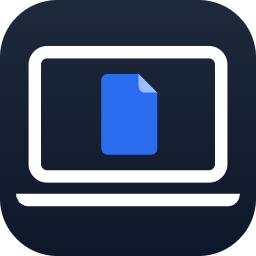
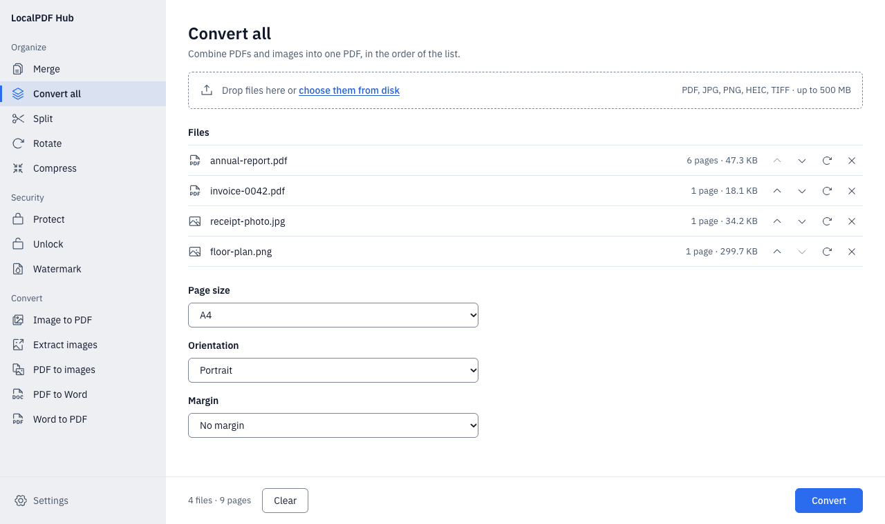
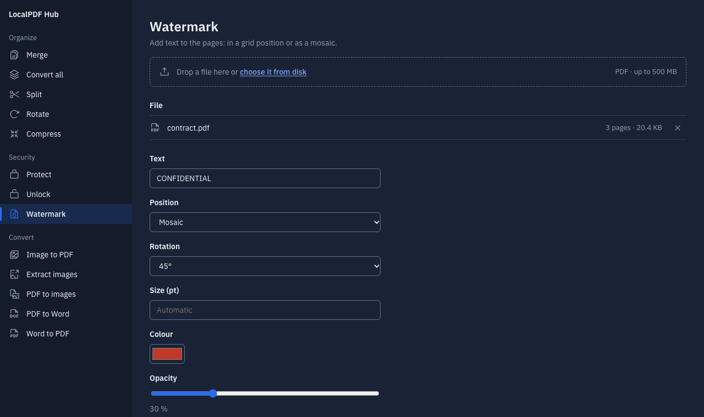

<h1> LocalPDF Hub</h1>

Herramientas de PDF que funcionan en tu propia computadora: unir, dividir,
comprimir, proteger y convertir, sin subir tus archivos a ningún lado.

[English](README.md)





Las capturas muestran la interfaz en inglés; en Ajustes se cambia a español.

## Qué hace

| Organizar | Seguridad | Convertir |
|---|---|---|
| Unir PDF | Proteger con contraseña (AES-256), escrita dos veces | Convertir todo: PDF e imágenes en un solo PDF |
| Dividir por páginas o rangos | Desbloquear un PDF del que tenés la contraseña | Imagen a PDF (JPG, PNG, HEIC, TIFF) |
| Rotar páginas | Marca de agua: posición en grilla o mosaico, rotación, tamaño, color y páginas | Extraer imágenes |
| Comprimir: recomendada, extrema o sin pérdida | | PDF a imágenes (PNG o JPG, de 72 a 300 ppp) |
| | | PDF a Word y Word a PDF |

## Tus archivos no salen de tu computadora

- La app es un servidor chico que solo escucha en `127.0.0.1`, y su propia
  página es la única que puede usarlo. No se envía nada por internet.
- Los archivos se procesan en una carpeta temporal de tu usuario y se
  borran apenas recibís el resultado.
- La interfaz funciona sin conexión: no carga fuentes, scripts ni
  analíticas de otros sitios.

## Descarga

Bajá la última versión desde
[Releases](https://github.com/alaancuevas/LocalPDF-Hub/releases/latest).

| Sistema | Archivo | Estado |
|---|---|---|
| macOS 12 o posterior, Apple Silicon | `LocalPDF-Hub-macos-arm64.dmg` | probado a mano y en CI |
| Windows 10 u 11, 64 bits | `LocalPDF-Hub.exe` | compilado y con prueba de humo en CI |

Las Mac con procesador Intel no están soportadas.

### Primera vez

La app no está firmada por Apple ni por Microsoft, así que el sistema avisa
la primera vez.

- **macOS:** abrí el `.dmg` y arrastrá LocalPDF Hub a Aplicaciones. Al
  abrirla, macOS dice que no pudo verificarla: tocá **Listo**, andá a
  **Ajustes del Sistema > Privacidad y seguridad**, tocá **Abrir
  igualmente** junto a LocalPDF Hub y confirmá.
- **Windows:** si SmartScreen dice que protegió tu PC, tocá **Más
  información > Ejecutar de todas formas**.

LocalPDF Hub se abre en tu navegador y agrega un ícono en la barra de menú
(macOS) o en la bandeja del sistema (Windows). Se cierra desde ese ícono.

### Word a PDF

Word a PDF usa Microsoft Word en Windows, o
[LibreOffice](https://es.libreoffice.org/) en cualquiera de los dos
sistemas. Si no hay ninguno instalado, esa herramienta lo avisa; las demás
funcionan igual.

### Usarla desde otro dispositivo

Para usar LocalPDF Hub desde un teléfono u otra computadora de tu red,
iniciala con la variable de entorno `LOCALPDF_LAN` con la IP de esta
computadora y abrí `http://<esa IP>:8000`. La app pasa a aceptar también
pedidos dirigidos a esa IP, así que activalo solo en una red de confianza.

## Compilar desde el código

Necesitás Python 3.12 y Node.js 22.

```sh
npm ci && npm run build          # pdf.js, la fuente y el sprite de íconos
python -m pip install -r requirements-build.txt
python -m pytest -q
python build.py                  # dist/LocalPDF-Hub.exe o .app y .dmg
```

Para usarla sin empaquetar: `PYTHONPATH=src python -m localpdf_hub`.
La API HTTP está en [docs/api.md](docs/api.md) y la interfaz en
[docs/DESIGN.md](docs/DESIGN.md) (en inglés).

## Mantenimiento

LocalPDF Hub lo mantiene una sola persona en su tiempo libre. Los issues y
pull requests son bienvenidos (ver [CONTRIBUTING.md](CONTRIBUTING.md)),
pero las respuestas pueden tardar. Para reportar un problema de seguridad,
seguí [SECURITY.md](SECURITY.md) en lugar de abrir un issue.

## Licencia

[MIT](LICENSE). Los componentes incluidos y sus licencias están en
[THIRD_PARTY_NOTICES.md](THIRD_PARTY_NOTICES.md).
